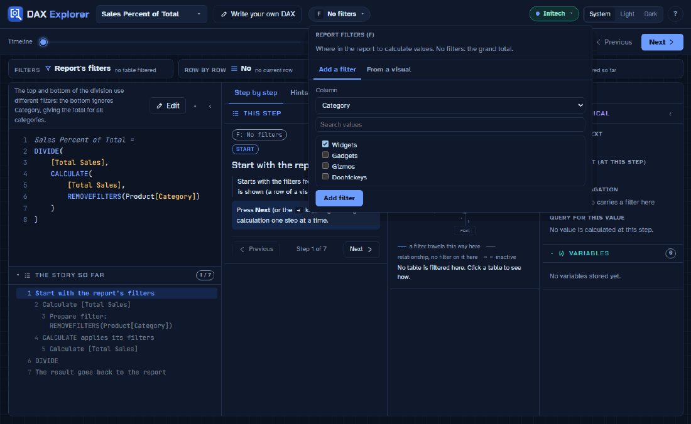

# DAX Explorer

Step through how a DAX measure is calculated, one step at a time, with the real values from your
Power BI report at every step.



DAX is hard to learn because the most important part is invisible: which filters apply at each point
of a calculation, when DAX goes row by row, and when a row turns into a filter. DAX Explorer makes that
visible, like a debugger for measures. It is meant for people learning DAX and for experienced users
tracking down a wrong number.

## What it does

- **Steps, like a debugger.** Press Next to go through a measure in the order DAX evaluates it. Each
  step says where it runs (inside which CALCULATE or loop), **what changes** (filters added, replaced
  or removed, a row becoming a filter, a relationship switched on), and its value.
- **Real values from Power BI Desktop.** Connect to a report you have open and each step shows its
  value, worked out by Power BI's own engine. Values appear next to the code as you step, debugger style.
- **Step into measures.** When a measure calls another, step into it and back out again.
- **Report filters ("F").** Choose filters by hand, or take them from a visual: pick the visual and the
  row you are looking at, and the steps explain that exact number.
- **Filters between tables.** A small map shows which tables a filter reaches through relationships,
  including USERELATIONSHIP, CROSSFILTER and TREATAS, with date ranges for time intelligence.
- **Hints.** Likely mistakes (the variable trap, a filter that replaces your slicer, the sort-by-column
  trap), slow patterns (FILTER over a whole table, a measure per row of a fact table) and what DAX does
  without being asked.
- **Run with timings.** See how long a step takes, split into reading data and calculating, from the
  engine's own trace.
- **A Power BI External Tools button**, so DAX Explorer opens already connected to the report you are in.

DAX Explorer **never guesses**. What a measure does is decided by explicit, tested rules; anything the
app can't work out is marked "not checked" instead of being made up.

## Getting started

DAX Explorer has two parts: the app (React and TypeScript) and a small local helper (`DaxExplorer.exe`,
.NET) that serves the app and talks to Power BI Desktop.

Requirements:

- Windows, with Power BI Desktop for real values
- Node.js 24 (see `.node-version`)
- the .NET 10 SDK, to build the helper (see `helper/global.json`)

Build and run:

```sh
npm install
npm run package   # creates release/DaxExplorer/DaxExplorer.exe
```

Then start `release/DaxExplorer/DaxExplorer.exe`. It opens DAX Explorer in your browser and stays in
the taskbar's notification area. From the data button you can:

- **Use sample data**: opens the made-up Initech report in Power BI Desktop and connects to it.
- **Connect** to a report you have open in Power BI Desktop. Nothing is read until you choose one.
- **Add to External Tools**: adds a DAX Explorer button to Power BI Desktop's External Tools ribbon
  (Windows asks for administrator rights once).

Without a connection, DAX Explorer still explains DAX using its built-in examples.

### How it stays local and safe

- The helper listens on `127.0.0.1` only (this computer, never the network) and checks host names.
- Each start creates a random token, passed to the page in the address fragment; every request must
  carry it, so other websites can't read your model.
- It only runs read-only DAX queries, keeps model information in memory, and logs no model details.
- It only connects to reports open in Power BI Desktop, and only when you choose one.

## The Initech sample

All examples use **Initech**, a made-up company (Sales, Product, Customer, Plant, Date), shipped as a
Power BI project in `samples/Initech`. Every table is calculated from DAX in the project itself, so it
has no data sources and nothing to refresh.

## Development

| Script                  | What it does                                                   |
| ----------------------- | -------------------------------------------------------------- |
| `npm run dev`           | The app with hot reload (built-in examples only)               |
| `npm run dev:connected` | The app with hot reload plus the helper (Power BI connection)  |
| `npm run package`       | Build `release/DaxExplorer/DaxExplorer.exe`                    |
| `npm run build`         | Type-check and build the app to `dist/`                        |
| `npm run lint`          | Lint with oxlint                                               |
| `npm test`              | Run the app's tests (Vitest)                                   |
| `dotnet test helper`    | Run the helper's tests                                         |

Project layout:

- `src/engine/`: the DAX engine (lexer, parser, function catalog, binder, the context analysis, the
  steps and the hints). Plain TypeScript with no UI dependencies; the linter enforces this.
- `src/app/`, `src/components/`, `src/styles/`: the React user interface.
- `helper/`: the local helper (C#, ASP.NET, ADOMD.NET and AMO).
- `samples/Initech/`: the synthetic sample report.

## Credits

The fonts are Chakra Petch, Atkinson Hyperlegible and JetBrains Mono, under the SIL Open Font License
(licence files in `public/fonts`).

## License

[MIT](LICENSE)
